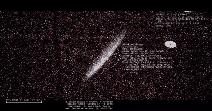
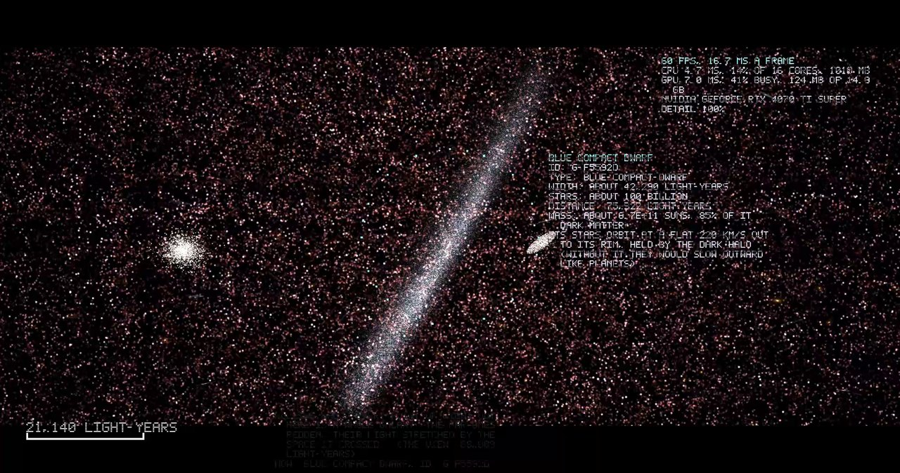
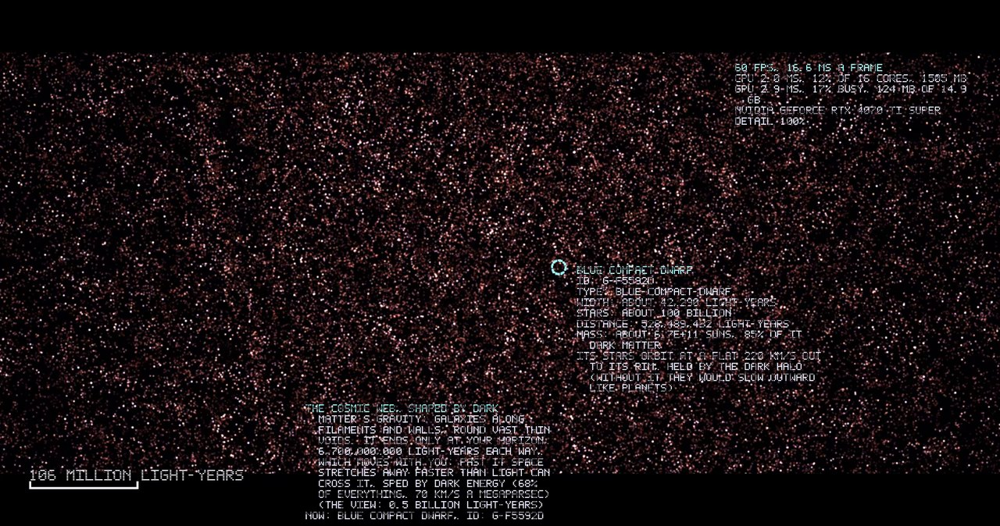
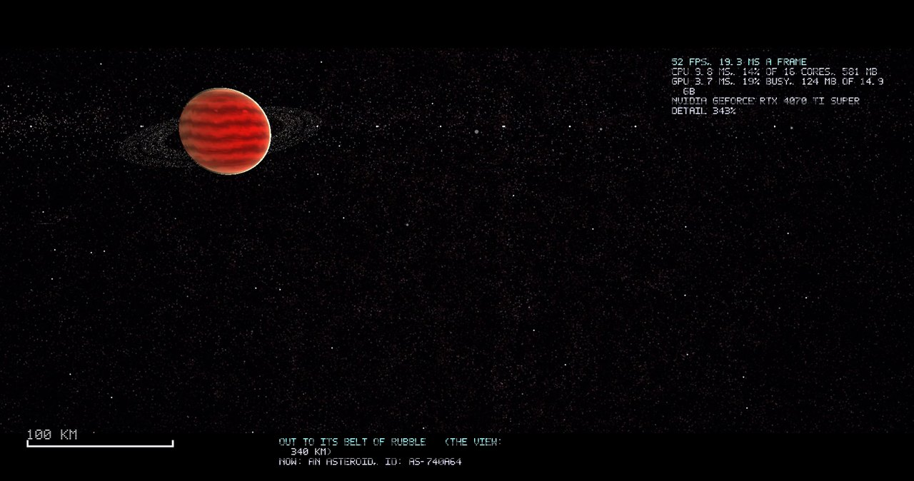
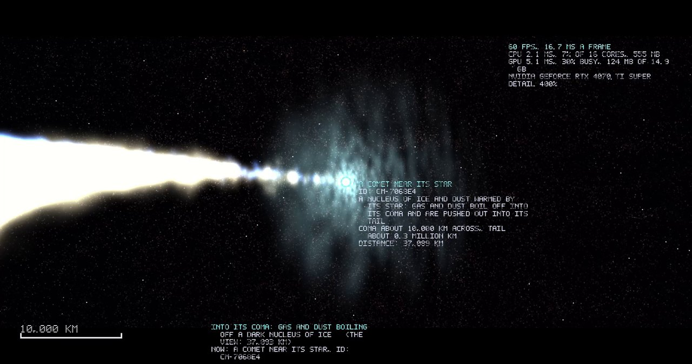
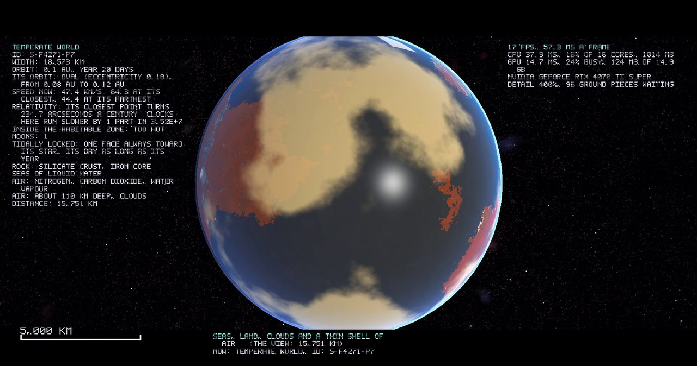
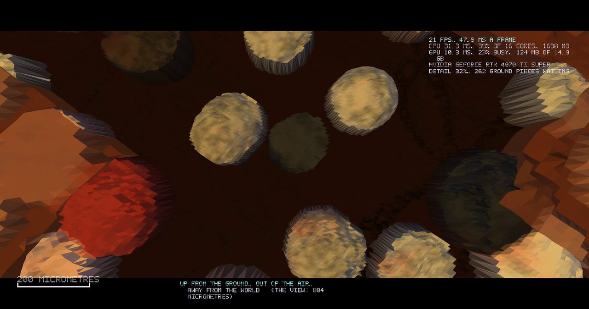
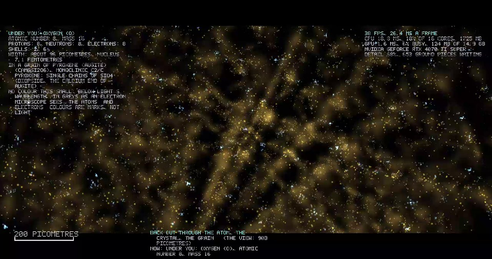
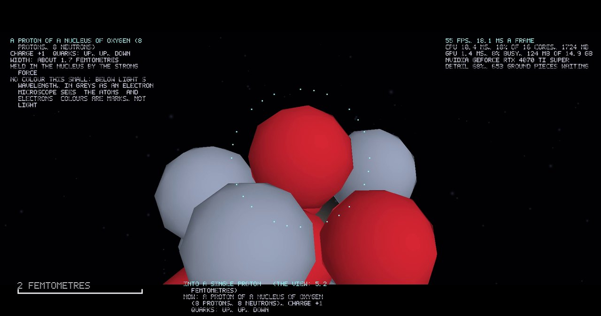
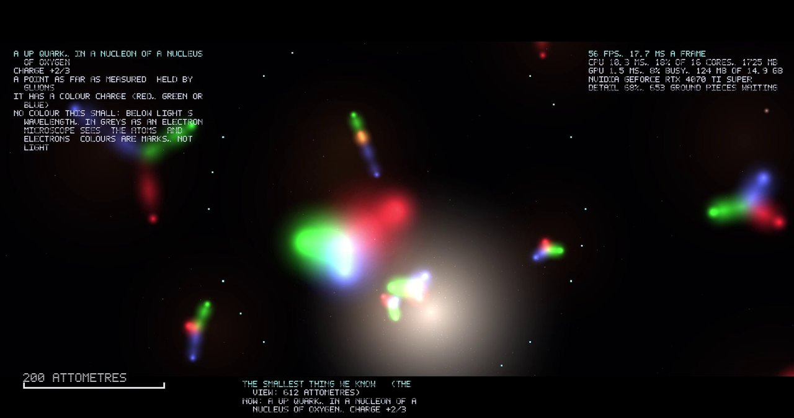

<p align="center"></p>

<h1 align="center">Universe</h1>

<p align="center"><b><i>One camera. One universe. From the cosmic web down to a quark.</i></b></p>

<p align="center">
  <a href="https://github.com/Unity-Lab-AI/Universe/releases/latest" title="The latest release on GitHub: the installer and the zip"><b>Download the latest release</b></a>
  &nbsp;|&nbsp;
  <a href="https://git.unityailab.com/GFourteen/Universe/releases" title="The same release on Unity AI Lab Git"><b>Unity AI Lab Git</b></a>
</p>

> **Get it in one minute.** The current release is **0.1.0**. Download **[Universe-Setup-0.1.0.exe](https://github.com/Unity-Lab-AI/Universe/releases/download/v0.1.0/Universe-Setup-0.1.0.exe "The installer, 0.7 MB, from GitHub")** (0.7 MB) and run it, or the **[zip](https://github.com/Unity-Lab-AI/Universe/releases/download/v0.1.0/Universe-0.1.0-windows.zip "Universe-0.1.0-windows.zip: unpack anywhere and run Universe.exe")** to unpack anywhere and run `Universe.exe`. The same two files are on **[Unity AI Lab Git](https://git.unityailab.com/GFourteen/Universe/releases "The release on the lab's own Git")**. Needs Windows 10 or 11 (64-bit) and a Direct3D 12 graphics card; installed it is 1.6 MB, the whole universe, nothing downloaded after. **On Linux**, take the zip and run the script inside it, through Wine: [On Linux](docs/LINUX.md "Universe on Linux, through Wine: one script"). What you get: a visible universe of about 100 billion galaxies to fly through with one camera, from the cosmic web down to the quarks inside a grain of sand, a guided tour (press **T**), and a card on everything you click.

<p align="center">Windows 10 and 11 &nbsp;·&nbsp; Direct3D 12 &nbsp;·&nbsp; 1.6 MB installed &nbsp;·&nbsp; 13.4 billion light-years &nbsp;·&nbsp; 100 billion galaxies &nbsp;·&nbsp; down to the quarks and below &nbsp;·&nbsp; built from scratch</p>

<p align="center">
  <a href="docs/COMPARED.md" title="Size, scope and performance against the other universe programs">Against the field</a>
  &nbsp;·&nbsp;
  <a href="docs/GUIDE.md" title="Add kinds of worlds, stars and galaxies, change the laws of physics, write tours">Build your own universe</a>
  &nbsp;·&nbsp;
  <a href="docs/HOW-TO-BUILD.md" title="Build it, make the installer, find your way round the code">Technical guide</a>
  &nbsp;·&nbsp;
  <a href="docs/LINUX.md" title="Universe on Linux, through Wine: one script">On Linux</a>
  &nbsp;·&nbsp;
  <a href="CREDITS.md" title="Who made it, and the science it is made from">Credits</a>
</p>

---

## Fall through everything



*The grand tour, as the program records it: from the cosmic web into a galaxy, past its stars, to a comet, down to a world, its ground and the face of one grain.*

Pull back and galaxies are pinpoints on the **cosmic web**. Roll the wheel and one grows into an island of stars. Keep going.

| You are | What you see |
|---|---|
| **Among the galaxies** | 100 billion of them, strung along filaments and walls round great empty voids |
| **Inside a galaxy** | A hundred billion stars, made round you as you fly |
| **At a star** | Its worlds, moons, belts and comets swinging round it |
| **Over a world** | Seas, mountains, clouds, ice caps, volcanoes, rings |
| **Under the sea** | Down through the water, the light dying with depth, to the bed and its silt |
| **On the ground** | Stones, then grains, then the steps of a crystal's face |
| **In the matter** | Atoms, their electrons, the nucleus, its protons and neutrons, and the **quarks** inside them; a star's layers from its photosphere down to its core, each its own plasma; a giant's core, a neutron star's crust, a nebula's gas |

Straight from the grand tour, as the program records it (the frame counter and the card are its own):

<table>
<tr>
<td width="33%"><br><b>Among the stars of a galaxy</b></td>
<td width="33%"><br><b>The cosmic web</b></td>
<td width="33%"><br><b>A gas giant from its belt</b></td>
</tr>
<tr>
<td width="33%"><br><b>A comet near its star</b></td>
<td width="33%"><br><b>A temperate world</b></td>
<td width="33%"><br><b>On the ground</b></td>
</tr>
<tr>
<td width="33%"><br><b>Inside a crystal</b></td>
<td width="33%"><br><b>A nucleus</b></td>
<td width="33%"><br><b>The quarks</b></td>
</tr>
</table>

> **No loading screens along the way.** One camera across about 42 factors of ten, and you can turn round anywhere and fly all the way back out. Below the quark the zoom in simply goes on: there is no floor.

---

## Two things in one

| | |
|---|---|
| **A universe to fly through** | Install it, press **T**, and watch the grand tour from the cosmic web to a quark; it ends with a true count of how much of the universe it reached. Then take the controls and go anywhere. |
| **A toolkit to build universes** | Every galaxy, star and world grows from a **template** in plain text. Add your own kinds and use it for your own **game or simulation**. |

---

## Take it

Universe is built to be taken. It is **MIT licensed**: use it, change it, sell what you build with it, no permission needed. Any project of any kind that needs a universe:

| | |
|---|---|
| **A game** | Your worlds, grown from your templates, in your own style: the generators and the camera are yours to keep |
| **A simulation** | Real orbits, real physics numbers, a universe that is the same every run from one seed |
| **A film or a screensaver** | Write a tour in plain text and film it in the program |
| **A classroom** | Fly from the cosmic web to a quark, with a card on everything you click (its letters rimmed dark, so they read on a black sky and a white surface alike) |
| **A piece of it** | The waveform engine, the galaxy maker, the star systems, the ground, the matter: each is its own folder of plain C#, with no packages to drag along |

Rename it, swap the icon, change the content, and `release.cmd` makes your installer. [Build your own universe](docs/GUIDE.md "Templates, worlds, stars, galaxies, physics, tours") shows the templates; the [Technical guide](docs/HOW-TO-BUILD.md "Build, ship and change the code") shows the code.

---

## A whole universe in under 2 MB

| | |
|---|---|
| **Download** | 0.74 MB installer |
| **The program** | 1.21 MB |
| **Every template** | 0.30 MB of plain text |
| **Everything installed** | 1.6 MB (2.3 MB with the uninstaller) |
| **What it holds** | About 100 billion galaxies of about 100 billion stars each: some 10²² stars, every one with its own worlds, and every world down to its grains and their atoms |

That's less than one photo from a phone. It fits because **nothing in it is stored. Everything is grown.**

| | |
|---|---|
| **A seed, not a save** | The whole universe comes from one starting number. Every galaxy, star and pebble is worked out from that number and where it is, so it never needs to be kept: come back to a star and it's worked out again, exactly the same |
| **Templates, not copies** | A lava world isn't a picture of a lava world. It's a dozen lines of rules (where it forms, how big, what colours, how fast it spins), and every lava world in the universe is grown from those same lines |
| **Equations, not pictures** | The roughness of a mountain, a stone or a grain's face is a few waves of the waveform engine, kept as their equations, not as images. Zooming in just works out the next, finer wave |
| **Only what you can see** | Galaxies are made in the regions round you, stars in the cubes round you, ground in pieces finer the closer you are, atoms round the point you dive into. What you leave behind is let go, and made again if you return |
| **The graphics card does the work** | The fine detail, the stars' colours, the web of galaxies' light are worked out on the card for each pixel, every frame, instead of being loaded from disk |

So the 1.6 MB is the **recipe**, not the meal: the rules of the universe, and the code that follows them.

### Against the field

Nothing else goes from the cosmic web to a quark in one unbroken camera, and nothing but two tiny pioneers of the 1980s and 2000s comes near the size; the nearest in scope, SpaceEngine, is more than two thousand times bigger and stops at the ground. The full comparison, with every project's own published numbers, what each needs and how Universe runs, is its own page: [**Against the field**](docs/COMPARED.md "Size, scope and performance against the other universe programs").

---

## Templates, not things

Every kind of world is a few lines of text, and **every world made from it is its own**:

```
@terrain lava
name: A lava world
forms: rocky
orbit-hz: 0..0.085
day-hours: 10..40
air-colour: 1 0.42 0.18
molten: yes
```

That makes a lava world wherever an orbit hugs its star, each with its own size, spin and colours. Write a new entry and **your** kind turns up across every universe. See [Build your own universe](docs/GUIDE.md "Step by step: worlds, stars, galaxies, physics, tours").

---

## How the zoom never ends

| | |
|---|---|
| **The moving anchor** | The camera measures itself from something close (a galaxy, a star, a world, a grain, an atom), so everything near you is exact |
| **The waveform** | Our own **CDF 9/7 wavelet** engine (the maths family behind JPEG 2000) stores shapes as waves; zooming in adds the next octave |
| **Mode-E** | Past the stored waves, detail keeps growing (Newton's method on *z³ − K*) and never repeats |
| **Real steps** | Close in, a grain's face steps in single **atomic layers**, then shows its **atoms**, before the atoms themselves arrive |
| **No floor** | Past the quark, which shows no size down to 10⁻¹⁹ m, the zoom in keeps going: past the Planck length, as far as a number can count. The scale bar says where you are and the card says what is known there, which is nothing. Outward there is no edge: what you see ends at your horizon, which is centred on you and moves with you |

---

## Built from nothing

| | |
|---|---|
| **No engine** | Not Unity, not Unreal, not Godot. The engine is ours: the window, the input, the renderer, the camera, the generators, the physics, the tour, the cards, even the font |
| **No libraries** | No packages, no downloads, nothing to install to build it. It talks to the graphics card and to Windows directly, through declarations we wrote |
| **No art** | No pictures, no textures, no models, no sound files. Every galaxy, star, world, cloud, stone, grain and atom is worked out from its seed, every frame |
| **No build tools** | One command, and the C# compiler that is already inside every copy of Windows. That is the whole toolchain |
| **Our own formats** | The content format, the wavelet engine, the icon drawer, the installer, the document viewer, the PNG and GIF writers: ours |
| **What it borrows** | Windows itself: Direct3D 12 and its shader compiler for the card, Media Foundation to pack a clip as MP4, the framework's Deflate inside a PNG. Nothing from anywhere else |

About 21,800 lines of C# and shader code in 65 files, and about 11,400 lines of templates in 30. That is the whole thing.

---

## Real physics, all four forces

| Force | What it does here |
|---|---|
| **Gravity** | Orbits follow Kepler's law, each body's speed from its orbit. Every world and moon has its mass from its size and its kind's density; a body's card gives its mass, the pull at its ground, its escape speed, and its pull where you are. Turn gravity off in the Time menu and watch what it was holding. Black holes have real horizons and bend the light behind them, and their shadow is the size the law gives from where you stand. Relativity turns each orbit's closest point round its star, and slows clocks in a gravity well: your own clock against far clocks is in the title wherever you are, a world's card gives the microseconds a day its pull costs the ground's clocks and a satellite's gain, and at a horizon your clock stops against far clocks |
| **Electromagnetism** | Electrons in their real shells and orbitals, bonds as shared electrons, stars the colour of their heat |
| **Strong force** | Packs every nucleus, and glues the quarks in every proton and neutron |
| **Weak force** | Decides which nuclei are stable, and the rest decay before your eyes: each unstable atom goes at its own moment by its half-life, its alpha or electron flung out, and the card says what it has become |

Every law's numbers are in `content/physics.unt`. **Change them, and you change the physics.**

---

## What's out there

| | |
|---|---|
| **Black holes** | Every one spinning, its disc reaching closer in the faster it spins, its horizon pulled in and space swept round it (frame dragging sweeps you round). A giant at every galaxy's heart, more among the stars. Feeding ones blaze with discs and jets, a supermassive one tearing several stars apart at once; quiet ones are a shadow and bent starlight. Zooming in at the shadow flies down to the horizon with the disc all round and the shadow growing to fill the view, then falls through: black, the gravity well itself round you as a grid (Flamm's surface outside the throat, its inner surface down to the point), your escape speed, time left and tide on the card, to the singularity at the quarks' size |
| **Worlds of every kind** | Temperate, ocean, desert, lava and ice worlds, gas giants, ice giants and hot Jupiters. Some have **rings**. Those that orbit close to their star are **tidally locked**: one face always toward it, a day as long as a year |
| **Moons** | Worlds in their own right: mostly airless rock or ice, now and then an ocean, a lava world or one with air |
| **Orbits** | Never perfect circles: every orbit an ellipse, most gently oval, some long and wild, each body fastest at its closest point |
| **Comets** | A dark nucleus from a hundred metres to tens of km across in a glowing coma up to a million km wide, an ion tail straight from the star and a curved dust tail, tens of millions of km long: seen right across their system |
| **Asteroids** | Lumpy, cratered rock in a star's belts, every one its own size, from tens of metres to hundreds of km across, and its own shape (the smaller the lumpier, round only once gravity has pulled it so), every one on its own orbit round its star by Kepler's law (the comets on long ellipses, sweeping in close and far out; the belts' haze turning at its own rate), each of a real kind by its place in the belt (stony, carbon-rich, metal, enstatite, basalt, dark and icy), and each body's own shares of its kind's minerals, no two the same; its card gives its minerals, its elements down to the traces, and where each element was forged (the big bang, dying stars, exploding massive stars and white dwarfs, merging neutron stars); and each is a world like any: landed on, its ground, grains and atoms zoomed into the same way |
| **Nebulae** | Emission nebulae glowing red and teal round their hot young stars, reflection nebulae blue with dust, planetary nebulae as thin shells round the white dwarf that puffed them off, supernova remnants as torn filaments, dark clouds of dust and molecules: each a cloud you fly into, in the colours of what it is made of, and its gas dived into to the atom |
| **Wanderers** | Neutron stars and rogue planets drifting between the stars, a neutron star's crust of iron nuclei dived into |
| **Supernovae** | Every galaxy's own, two to five a century, of every real kind and in every stage, as bright as physics says from where you are: up close a fireball ten billion km across in the colour of its heat inside the ballooning cloud of its flung matter, then a shell standing for a hundred thousand years with the neutron star, black hole or magnetar born at its middle; the star that died is gone with its worlds, and its neighbours are scorched |

**Dead, but alive.** There's no life yet, but every world runs on its own clock: plates drift, volcanoes erupt, ice ages come and go, and rocks from space leave craters.

---

## Controls

| Key | Does |
|---|---|
| **Mouse wheel** | Fly toward what the mouse points at; you slow as you close in |
| **Ctrl + wheel** | Eight times faster |
| **W A S D, Q / E** | Fly like a first-person game; **Shift** for four times faster |
| **Left click** | Pick anything: a galaxy, star, world, spot, grain or atom |
| **Right click** | Let go |
| **Drag** | Circle what you picked, or look around |
| **Space · , · .** | Pause time · slower · faster (it starts at a minute a second) |
| **H** | The scale bar and info cards, on or off (picking something brings them back) |
| **B** | Among atoms: glide across the bond to the next one |
| **T · R** | The grand tour: start or carry on · start again |
| **F12 · F9** | A screenshot · start or stop a clip (Clip format on the landing page or under View: MP4; .cdf97w, the clip as CDF 9/7 waveforms and their metadata, worked out on the graphics card as each frame is drawn; or the .cdf97w of the universe itself, no pixels: the seed and the camera's track, a few hundred KB for ten minutes, drawn again at any size (its playback is being built); a filmed tour also leaves a .cdf97u, its seed and tour in a few lines, that Play flies again through the same universe; Clip size there too: auto, full, half or quarter of the screen; in a smaller clip the text is drawn larger, so it reads) |

The **Time** menu has **Always day**, on to start with; turn it off for true day and night. It also has **Gravity**: turn it off and every body goes straight on at its speed, every star is blown apart by its own pressure, and a galaxy's stars fly off on their tangents. **View** has drag speed, FPS with the GPU and CPU stats, render scale, GPU use, the clip's size, and **the periodic table**: all 118 elements, each shown as it really is at a temperature and pressure you set (the arrow keys), a click on any for its details; Escape brings you back to where you were. **Help** has every guide, and **Help > Documents** lists them all, what each is made of and when to read it.

---

## The grand tour

A film of the scale of things, from the cosmic web down to a quark and all the way back out.

| | |
|---|---|
| **Shot afresh every time** | Each shot picks its own way round, speed and crane |
| **A true crossing** | Billions of light-years, straight to one far galaxy, made from its own place before you set off |
| **A feeding black hole** | It crosses to a galaxy whose heart is feeding, flies down to it, round its accretion disc and skims it in its own plane, edge-on through the light it bends, in to the shadow at its horizon, and through it: the fall in black down the gravity well itself, looking back at the horizon, on the law's own clock to the singularity at the quarks' size, and back out: with its jets, if it fires them. The disc is gas on its own orbits, the inner ones round fastest, brighter on the side coming at you; stars are swept round the hole on tight ellipses; and a star that came too close is torn into a stream and swallowed |
| **A supernova** | On the way out it finds a supernova going in the galaxies round you (else the youngest remnant): the fireball or the shell, and what was born at its middle |
| **A world, down to its quarks** | A world's seas, land and air from orbit, down to the ground, a grain of it, the crystal's lattice, one atom, its electrons, its nucleus and a quark, and back out; a star's system with an asteroid of its belt and a comet seen close on the way; about a quarter of an hour in all |
| **Pause any time** | A click, the wheel or a key; a note says why. **T** carries on, **R** starts again |
| **Film it** | Tick **Film the tour** on the landing page; the **Clips** list plays them back |
| **Write your own** | A tour is a plain-text list of camera moves (`content/tours/grand-tour.unt`) |

---

## Start

1. **Download** the installer from the links at the top, and run it. Over an earlier copy it offers to delete your old clips, screenshots and settings, each on its own.
2. **Pick a seed** on the landing page (or **Random**, or leave it blank).
3. **Begin** to fly, or **Take the tour**.

A bar shows the universe being made, then it opens, whole.

---

## Still to come

Universe is a 0.1 preview of a program that is finished in its shape and growing in its depth. What it still owes, on its own:

| | |
|---|---|
| **Gravity as a live force** | Orbits shaped moment by moment by every body's pull (today every orbit follows Kepler's law exactly; the switch to turn gravity off is in) |
| **The fields** | The fields that particles are waves in, below the quarks' points |
| **Light below its wavelength** | Today the grain's face goes to greys there, as an electron microscope sees; a true rendering of light that small is for later |
| **The waveform everywhere** | The CDF 9/7 waveform carrying every field from the cosmic web to the microbes: gas and star fields, the ground itself, clouds, stars' surfaces |
| **Native Linux and Mac** | Today Linux runs it through Wine with the script in the zip; native builds come with their own windowing and graphics |
| **Screens in these pages** | The landing page, the installer and the document viewer, from the program itself |

What it will never hold is life: that grows in **DNA-AND**, the game the lab builds on this universe.

---

## Which guide

| | Who it is for | What is in it |
|---|---|---|
| **This page**, and the **Help** menu's pages in the program | Anyone, in plain words | What it is, how to fly it, how it works |
| [**Against the field**](docs/COMPARED.md "Size, scope and performance against the other universe programs") | Anyone | Size, scope and performance beside the other universe programs, with their own published numbers |
| [**Build your own universe**](docs/GUIDE.md "Templates, worlds, stars, galaxies, physics, tours, features") | Builders: no code needed | Add kinds of worlds, stars and galaxies, change the physics, write tours |
| [**On Linux**](docs/LINUX.md "Universe on Linux, through Wine: one script") | Linux users | Run it through Wine with the script in the zip; the Steam way; what is and is not yet proven |
| [**Technical guide**](docs/HOW-TO-BUILD.md "Build, ship and change the code") | Coders (the code is dense: unless you are an advanced one, we suggest an AI coding assistant for changes) | Build it, ship it, find your way round the code, change it |

**Help > Documents** in the program lists every guide, what each is made of and when to read it.

Plain **C# 5 on Direct3D 12**, built with the compiler that comes with Windows. No packages, no outside libraries, no stored art.

---

<p align="center">Made by the <b>Unity AI Lab</b> · four people, open-source, built on stubbornness<br>
<a href="https://unityailab.com" title="The Unity AI Lab">unityailab.com</a> &nbsp;·&nbsp; <a href="CREDITS.md" title="The team, and the science it is made from">Credits</a></p>
