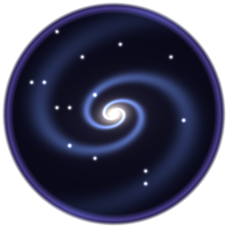

<p align="center"></p>

<p align="center">
  <a href="../README.md" title="What Universe is, and how to fly it">Universe</a>
  &nbsp;·&nbsp;
  <a href="GUIDE.md" title="Add kinds of worlds, stars and galaxies, change the laws of physics, write tours">Build your own universe</a>
  &nbsp;·&nbsp;
  <a href="HOW-TO-BUILD.md" title="Build it, make the installer, find your way round the code">Technical guide</a>
  &nbsp;·&nbsp;
  <a href="../CREDITS.md" title="Who made it, and the science it is made from">Credits</a>
</p>

# Build your own (technical)

> Universe is plain **C# 5 on Direct3D 12**, built by the C# compiler that ships with Windows. No packages, no outside libraries, no stored art: everything on screen is made at run time from a seed and the templates in `content/`.

For adding kinds of worlds, stars and galaxies without touching code, start with **Build your own universe** (`docs/GUIDE.md`). This page is for building, shipping and changing the code.

---

## Everything above the compiler is ours

What is scratch-made and what comes from Windows, layer by layer. Nothing is downloaded and nothing is installed: no packages, no engine, no libraries, no stored art.

| Layer | Ours | From Windows |
|---|---|---|
| **Toolchain** | `build.cmd` and `release.cmd`; every warning an error | `csc.exe`, the C# 5 compiler inside the .NET Framework that ships with Windows |
| **The window** | `Win32.cs` (our own declarations), `Window` (the window and the menus), `Input` (keys and mouse), `Launcher` (the landing page), `DocViewer` (Markdown rendered to rich text, tables and links included), `Settings`, `Watchdog`, `Stats` | `user32`, `gdi32`, `kernel32`, `psapi`, the RichEdit control |
| **Graphics** | `D3D12.cs` and `Com.cs` (Direct3D 12 and DXGI called through their COM method tables by hand), `Gpu` (device, swap chain, fences, a frame in flight, timestamps, the DRED crash record in `GpuLog`), `Pipeline` and `MeshPipeline` (root signatures, pipeline states, the HLSL shaders compiled as the program starts), `Draw`, `UploadBuffer` | `d3d12.dll`, `dxgi.dll`, `d3dcompiler_47.dll` |
| **Maths** | `MathCore`, `Wavelet97` (CDF 9/7), `Waveform`, `ModeE`, `Physics` | nothing |
| **Content** | The content format and `Content.cs`, its reader; 30 template files | nothing |
| **Generators** | `GalaxyGen`, `StarGen`, `SpaceGen`, `PlanetGen`, `PlanetTerrain`, `BodyGen`, `GrainField`, `ElementGen`, `IconFont` (the blocky letters on screen) | nothing |
| **Simulation** | `PlanetCore`, `PlanetPlates`, `PlanetSurface`, `PlanetAir`, `PlanetWeather`, `PlanetImpacts` | nothing |
| **Views** | `UniverseView` (the camera, the zoom, picking, the cards, time, the tour), `MatterView`, `ScaleHud`, `PreviewText` | nothing |
| **Captures** | `PngWriter` (chunks, filters, checksums), `GifWriter` (palette and LZW), `Mp4Writer` (each frame handed to a sink writer) | Media Foundation for the H.264 inside an MP4; the framework's Deflate inside a PNG |
| **Shipping** | `Setup.cs` (the installer wizard, carrying the payload inside itself), `MakeIcons` (the icons drawn by code) | Windows Forms for the wizard's controls |

About 18,000 lines of C# and shader code in 61 files, and about 10,000 lines of templates in 30.

---

## What you need

| | |
|---|---|
| **Windows 10 or 11**, 64-bit | |
| **A Direct3D 12 graphics card** | The program picks the strongest one in the computer |
| **Nothing to install** | The compiler is `%WINDIR%\Microsoft.NET\Framework64\v4.0.30319\csc.exe`, part of Windows |

---

## Build it

```
build.cmd                 builds build\Universe.exe
build.cmd NAME            builds build\NAME\Universe.exe, a separate copy
```

Every warning is an error (`/warnaserror+`), so a build that finishes is clean.

### Start-up options

| Option | What it does |
|---|---|
| *(none)* | Opens on the landing page: the seed, Begin, the tour, the settings, the guide |
| `--seed N` | Opens the universe of that seed again |
| `--tour grand-tour` | Flies the guided tour (any tour in `content/tours/`) |
| `--record clip.mp4` | With `--tour`, films the whole tour as an MP4 |
| `--shots S` | Saves a PNG of the game every S seconds |
| `--native` | Opens at your screen's full resolution |

Screenshots (**F12**) and clips (**F9**) go in `captures` beside the program.

---

## Make the installer and the zip

```
release.cmd
```

This builds the release copy and packs it, the `content` folder and the documents into our own installer (`installer\Setup.cs`, no outside installer tools). It writes:

| File | What it is |
|---|---|
| `release\Universe-Setup-<version>.exe` | Installs to your Programs folder, with Start menu and desktop shortcuts, an Apps list entry and an uninstaller. Over an earlier copy it offers to delete what that copy left behind, each on its own: its clips, its screenshots, its settings |
| `release\Universe-<version>-windows.zip` | The same files, to unzip and run |

Change the version at the top of `release.cmd`.

---

## Where things are

| Folder | What it holds |
|---|---|
| `content/*.unt` | **The templates** the universe grows from: the universe itself (`universe.unt`), galaxies, stars, each kind of world and where it forms (`terrain.unt`), zones such as the liquid-water zone and the frost line, the 118 elements, minerals and ground mixes, physics laws and gases, tours (`tours/`) |
| `src/core` | Maths: vectors, matrices, random numbers, the CDF 9/7 wavelet (`Wavelet97`), mode-E (`ModeE`), and the waveform that gives every surface its detail (`Waveform`); reading content (`Content`) |
| `src/gen` | The making: galaxies (`GalaxyGen`), star systems and which kind of world forms where (`SpaceGen`), a world's ground and its own traits from its template (`PlanetTerrain`), bodies in space (`BodyGen`), grains (`GrainField`) |
| `src/shell` | The universe view (`UniverseView`: camera, zoom, picking, info cards, time, days, the tour), the scale and cards on screen (`ScaleHud`), the matter below the ground (`MatterView`), the Help menu's documents (`PreviewText`) |
| `src/render` | Direct3D 12: the device, picking the graphics card, timing its work, the point and mesh pipelines and their shaders |
| `src/platform` | The window, input, menus, the landing page (`Launcher`), settings (`%LOCALAPPDATA%\Universe\settings.txt`), the document viewer (`DocViewer`), the stats on screen (`Stats`), the watchdog (`Watchdog`) |
| `docs/` | The guides. They're built into the program too (`build.cmd`'s `/resource` lines), so **Help** shows the same pages; **Help > Documents** is the directory of them all (`docs/in-game/DOCS.md`) |
| `docs/img/` | The logo, the journey clip the readme shows, and the repo page's share images (`social.png` for the link preview, `avatar.png` for the repo's own picture) |
| `installer` | Our own installer, and the icons, drawn by our own `MakeIcons.cs` |

---

## How it holds together

| | |
|---|---|
| **Templates** | Each kind of thing is an entry in `content/` with ranges. A thing made from it takes its own value in each range from its seed (`PlanetTerrain.Instance`), so every world is its own and a seed always gives the same one. Which kind forms where is read from the template too (`SpaceGen.WorldKind`) |
| **One camera** | `UniverseView` keeps the camera as an anchor (a galaxy's centre, a star, a world) plus an offset, in double precision, so it's exact from light-years to atoms. Nothing switches views |
| **Zoom** | Each notch of the wheel moves a share of the way to the nearest thing, so it slows by itself and never runs out. Inward there is no floor: below the quark, `MatterView` keeps the point you ride (a quark or an electron) exactly at the focus with its glow filling the view, the scale bar names units down to quectometres and then the number itself, and the card says what is known there (nothing; below the Planck length, not even length). `MatterView.BottomKm` is only where double precision gives out. Outward, `HoldInside` keeps you inside the visible universe. W A S D Q E fly at half the distance to the nearest thing a second |
| **Depth** | Reversed floating-point depth (`Mat4.Perspective`, compare GREATER), so near and far never fight |
| **The galaxies** | About 100 billion in a sphere 13.4 billion light-years across, made in regions round you along the cosmic web (`SpawnRegion`: each region's own, from its place; nothing made while crossing faster than a couple of regions a frame); beyond them, a glow of points along the same web that fades in just where the galaxies made in full fade out. The tour's far galaxy is made ahead from its own region and held until you arrive (`FarGalaxy`) |
| **A galaxy** | One star field: the far view is the first part of the near view, so nothing swaps. Real stars round you are made in cubes (`real-stars-cube-ly`) at true density, every cube within the reach (`real-stars-reach-ly`) of where you are, each from its own position and kept while in reach |
| **Worlds** | Ground is built in the background on every core, finer under the camera. Changes (mountains, craters) are stored as CDF 9/7 wavelet terms and swapped in whole. The seas are dived into: within a metre of the water the floor becomes the sea bed (`UniverseView.Surface`), the view is fogged in the water's colour with the star's light dimmed by depth (`PlanetTerrain.Dim`), and at the bed the matter is the `ocean` mix with water molecules above its grains |
| **Grains and matter** | `GrainField` is one field of loose rock for a whole world. `MatterView` places grains, crystals, atoms, electrons and nuclei at their real sizes round where you dive in |
| **Detail at every size** | `Waveform`: stored CDF 9/7 waveforms, one per octave, and mode-E past them |
| **Clouds and patterns** | A world's cloud cover is worked out for each pixel on the card, so cloud edges are soft at any distance; every layer of noise, on the card and on the processor, is turned to its own angle, so no pattern lines up in rows |
| **The card's time** | Two Direct3D 12 timestamps a frame measure the card's work; the GPU use setting (10 to 90%) holds it there by turning the detail up or down |
| **The stats** | `Stats` samples twice a second: the processor's time on the frame (from its start to handing it to the card), the card's time (the timestamps), this process's share of every core (`GetProcessTimes`), its working set (`GetProcessMemoryInfo`), the card's memory in use and the budget it allows (`IDXGIAdapter3::QueryVideoMemoryInfo`), the detail and the ground backlog. `UniverseView` draws them under the FPS when `show-stats` is on (the View menu, or the landing page) |
| **Processor and card at once** | A frame is handed to the card and not waited for until the next frame's commands are recorded (`Gpu.BeginFrame`), so the next frame's game work runs while the card draws; freed buffers are held back eight frames, so the card never reads one let go |
| **Physics** | `Physics` (`src/core/Physics.cs`) reads gravity and light from `content/physics.unt`: Kepler orbits, pulls, escape speeds, black-hole horizons. `MatterView` reads the strong force, the protons' push, the binding-energy formula and beta stability for every nucleus |
| **Time** | `UniverseView.TimeSpeeds` sets how many years pass each second; a world's day is one turn of its spin (its template's `day-hours`) |
| **Tidal locking** | A world close enough to its star (`tidal-lock` in `content/physics.unt`) turns once each orbit: its day is its year, one face always lit |
| **Orbits** | Every orbit an ellipse (`orbits` in `content/physics.unt`); `Body.At` solves Kepler's equation, so each body is fastest at its closest point. Moons choose their kind from the same templates as planets (`moon-weight`) |

---

## Reading the code

Be warned before you open it: the code is **dense**. It is readable, but not the way a textbook is.

| | |
|---|---|
| **What it is like** | About 15,400 lines of code in 61 files. Most lines are ordinary (the middle line is 57 characters), but the hot paths are packed: one line in ten carries three or more statements, one in fourteen runs past 160 characters (the longest past a thousand), names are short, and the three big files are long (`UniverseView` 3,100 lines, `MatterView` 1,900, `PlanetTerrain` 1,550) |
| **How to read it** | By its comments. A fifth of all lines are plain English (1,900 comment lines and 1,200 trailing ones): every block says in words what it is about to do and why, with the physics and the numbers. Read the comment, then the statement under it, and the long lines unpack |
| **Where it is densest** | The per-pixel and per-frame work: the shaders (HLSL inside `Pipeline.cs` and `MeshPipeline.cs`), the camera and tour (`UniverseView`), the matter at its real sizes (`MatterView`), the ground (`PlanetTerrain`) |
| **Where it is easiest** | The content (`content/`: every template is a few plain lines), the generators' entries, `Physics`, `Stats`, `Settings`, the writers (`PngWriter`, `GifWriter`) |
| **The rule it follows** | Everything is said once, in English, next to the code that does it. Nothing is left for a reader to guess at; but nothing is spread out either |

---

## Change it

| You want to change | Go to |
|---|---|
| Kinds of worlds, stars, galaxies | `content/*.unt` (see **Build your own universe**) |
| A different universe | Change the seed: the same seed always makes the same universe |
| The look of points | The pixel shader in `src/render/Pipeline.cs` |
| Controls | `UniverseView.Update` |
| The tour's camera | `UniverseView.TourStep`, and the stops in `content/tours/` |
| The info cards | `UniverseView.Card` (what they say), `ScaleHud.DrawCard` (how they look) |
| The Help documents | `docs/` (built in by `build.cmd`'s `/resource` lines), shown by `DocViewer` |
| Minerals and elements | `content/minerals.unt`, `content/elements.unt` |
| The laws of nature | `content/physics.unt`, read by `Physics` and `MatterView` |

> **Keep it a toolkit:** read traits from templates, never test for a kind's name in code; give every trait a range; make things from their seed, never store them; and do heavy work on the graphics card.

---

## Licence and credits

**MIT.** Universe is built to be taken: use it, change it, ship it inside your own project, sell what you build with it, no permission needed; keep the licence notice with it. Made by the **Unity AI Lab**. [unityailab.com](https://unityailab.com)
